<div align="center">
  
</div>

<div align="center">

  <a href="https://github.com/julian-cao">
    
  </a>

  <br/>

  [](https://developers.google.com/profile/u/113745780895705509566)
  [](https://cloud.google.com/innovators/innovator?profileId=113745780895705509566&hl=en)
  [](https://www.linkedin.com/in/jianglancao/)
  [](https://x.com/julian_ai_data)
  [](https://medium.com/@jianglancao)
  [](https://github.com/julian-cao)

</div>

<br/>

## 👋 About Me

<table>
<tr>
<td width="60%" valign="top">

I'm an **Independent AI Application Developer** and **Head of Data & Analytics at [WPS Office](https://www.wps.com/)** — one of the world's most widely used productivity suites.

I work where **Generative AI, Cloud and Data** meet: designing LLM-powered applications from architecture to deployment, and building the data foundations that let products and teams make better decisions.

- 🌟 **Google Developer Expert** — AI & Cloud
- 🏆 **Google Cloud Champion Innovator**
- 🤖 Shipping **LLM-powered apps** end to end
- 📊 Leading **data strategy & analytics** at enterprise scale
- ✍️ Writing about applied AI and data on Medium & X

</td>
<td width="40%" valign="top">

**🎯 Currently focused on**

```yaml
building:   AI agents & RAG apps
platform:   Google Cloud · Cloud Run
models:     Gemini · Claude · OpenAI
leading:    Data & Analytics @ WPS
sharing:    Articles & community
```

**💬 Ask me about**

`Generative AI` · `LLM apps` · `GCP` · `BigQuery` · `Data strategy`

</td>
</tr>
</table>

## 🧭 Core Expertise

<div align="center">
  
</div>

## 🏅 Recognition

<div align="center">
<table>
<tr>
<td align="center" width="50%">
  <a href="https://cloud.google.com/innovators/innovator?profileId=113745780895705509566&hl=en">
    
  </a>
  <br/><sub><b>Google Cloud Champion Innovator</b></sub>
</td>
<td align="center" width="50%">
  <a href="https://developers.google.com/profile/u/113745780895705509566">
    
  </a>
  <br/><sub><b>Google Developer Expert · AI & Cloud</b></sub>
</td>
</tr>
</table>
</div>

## 🛠️ Tech Stack

<div align="center">

**AI & LLMs**


&nbsp;


**Cloud & Infrastructure**


**Data & Analytics**


**Development**


</div>

## 📈 GitHub Activity

<div align="center">
  
  
  <br/>
  
  <br/>
  
</div>

## 🤝 Let's Connect

<div align="center">

Always happy to talk about **AI, Cloud and Data** — feel free to reach out.

<br/>

[](https://www.linkedin.com/in/jianglancao/)
[](https://x.com/julian_ai_data)
[](https://medium.com/@jianglancao)
[](https://developers.google.com/profile/u/113745780895705509566)

</div>

<div align="center">
  
</div>
